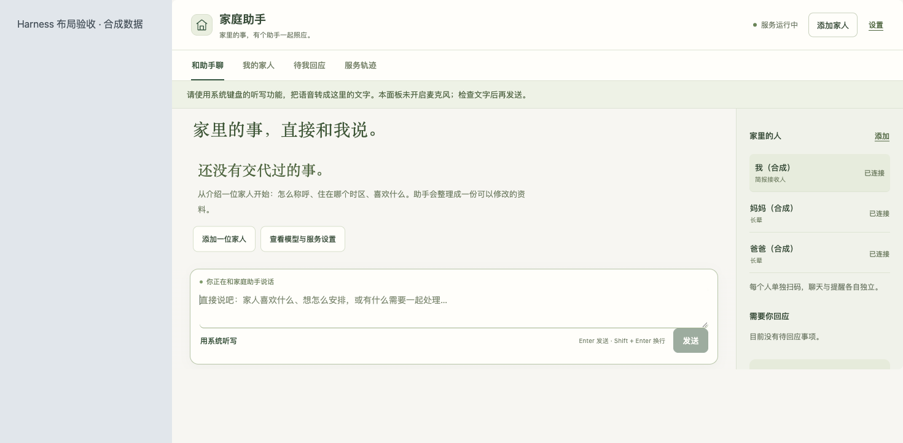

<h1 align="center">乐乐家庭助手 · 让爸妈在微信里各有一个自己的助手</h1>

<p align="center"><b>长辈不用装新 App、不用学新界面；你在一个工作台里照看，在自己的微信收每日简报。</b></p>

<p align="center">
  
  
  
</p>

<p align="center"><sub>界面预览为合成数据；实机微信投递仍需本人验证。</sub></p>

作者：牛村木木山 · MIT · 社区开源项目，非官方产品。

## 三步开通

1. **装。** 打开 Harness，新建会话 → 模式下拉选「创造模式」，发送：
   > 请从 npm 官方源安装并启用 `@oxmumu3/dsh-family-assistant@latest`。
2. **加人。** 先添加自己（简报接收人），再点「添加家人」，说一句「妈妈住上海，喜欢养花，日报短一点」；AI 整理成资料卡，补一句就能改。
3. **连接。** 每位成员本人用手机微信扫码确认；选好 Harness 模型，点「开始服务」。请家人在微信发一句「你好」，在手机上看到助手回复，就完成第一次试用。

新安装默认暂停、成员为空——不会自动扫码、不会给任何人发消息、也不会自动开日报。

第一次用下来如果帮上了忙，欢迎点项目页右上角的 **Star**，以后也方便回来找更新。安装卡住了，可以到 [Issues](https://github.com/oxmumu3/dsh-family-assistant/issues) 留下宿主版本和报错。

<p align="center">
  
</p>

## 为什么不是拉一个家庭群

- **长辈在熟悉的微信里说话。** 不装新 App，不换聊天对象，不学新界面。
- **每个人是自己的助手。** 各自的记忆、时区、日报时间、提醒队列互相隔离，不会串收件人。
- **你不需要接管他们的微信。** 电脑在你这里，服务在后台；家里人只负责说话。

它是一个 DeepSeek Harness Host：长辈各自在微信里聊天、设提醒、收个性化日报；Owner 在工作台管理，并接收每日服务简报。

## 家人能做什么

- 在微信里聊天、问答案，让助手写稿、解释、改自己的材料。
- 一句话设一次性或每日提醒，查询、改期、取消；记一条便条，之后查询或删除。
- 收自己的每日简报和城市天气；需要时做可编辑的 PPTX，下一句继续改。
- 对收到的日报直接评价、继续改稿；只有明确说「以后都这样」才保存为偏好。
- 长任务先接收再异步处理，可以发「进度」或「停止刚才的任务」；结果不清楚的操作不会自动重跑。

## 你能做什么（Owner）

- **一个工作台看全部**：家人资料、独立对话、提醒执行、连接状态、服务轨迹都在同一处；也可以直接查看已登记家人的本地聊天记录与成果。
- **在自己的微信里指挥**：说「给妈妈发今天的日报」「明早八点提醒爸爸浇花」；一次发送不改变每日推送开关。
- **每日服务简报**：实际服务条数、提醒投递状态、连接问题，以及已获分享授权的当天话题小结；先预览，再决定是否定时发送。
- **处理家人的转告**：家人在微信请助手转告一件事后，你在「待我回应」回复，助手署明代为转达，只带这一件事。
- **把事交回项目**：在控制台或微信查询已登记项目、派发原生任务并继续同一件事；可以指定另一位家人接收结果，但不会因此给他项目权限。

## 它怎么保护边界

- **每人独立**：账号、轮询、记忆、context token 和发送队列分别隔离，绝不回退到第一个收件人。
- **授权分开**：安装、绑定、来源启用、读取、定时推送是五件事；安装不等于开启，登录不等于扫描。
- **不假装送达**：「接口已接收」只代表微信 API 接受，不代表手机收到或已读；发送结果不确定时先核对，不自动重发。
- **暂停就真的暂停**：暂停后不主动处理或发送；暂停期间收到的来信只归档。
- **失败有说法**：网络不明、会话过期、来源未连接都会给出明确原因，不把保存配置当成已投递。

## 安装与版本

支持官方 Harness **0.2.1-rc.2 / rc.3 / rc.4 / rc.5 / 0.2.2-rc.1 / 0.2.2-rc.2 / 0.2.2-rc.3** 的 Web 或桌面宿主；三个 0.2.2 RC 按官方要求使用 Node.js 24.9+，旧宿主沿用 22.13+。0.2.2-rc.2 与 rc.3 以签名桌面包和对应精确 npm SDK 验证。

固定发行入口是 npm 的 [`@oxmumu3/dsh-family-assistant`](https://www.npmjs.com/package/@oxmumu3/dsh-family-assistant)，分享 `latest` 即可，不必记版本号。GitHub Release 里的 tgz 固定指向对应历史版本，不要拿它猜新包。

默认私有数据目录 `~/.local/share/dsh-family-assistant`，可用 composition 的 `storageDir` 指定独立目录；两个 Host 不要共用同一个目录。已有旧版升级见[安装与升级说明](docs/install.md)。

## 第一次使用

1. 添加自己，身份选「我自己（简报接收人）」。
2. 添加家人：介绍情况，核对资料卡，补充后确认创建。
3. 在每位成员的连接区分别生成二维码，由本人扫码确认。
4. 选择简报分享范围：「不纳入简报 / 仅服务摘要 / 服务摘要与聊天摘录」；默认不纳入。
5. 选模型、点「开始服务」，让长辈发一句「你好」测试，再设置提醒和日报时间。

工作台支持真实语音输入：点「说话」录音，停止后转成可编辑文字，由你检查再发送；识别在本机完成，不自动发送。默认音频最长 2 分钟。

## 边界与验证

Host 和电脑必须在线。发送依赖微信会话有效性与平台限制，过期需本人重新扫码。定时任务最多补触发最近两小时内的内容，过期事项会明确标记，不保证离线准点。网络结果不明的发送不自动重试。

代码测试、三路模拟联调、宿主挂载和工作台验收，与真实扫码、真实模型调用、定时实机投递及手机显示是不同的验证状态，详见[验收记录](docs/public-verification.md)。

## 开发与本地验证

```sh
npm ci --ignore-scripts
npm test
npm run demo
npm pack --pack-destination dist
```

`demo` 用真实业务、通道和协议模块，以 fakeFetch 拦截全部网络，跑 Owner + 两位长辈的登录、回复、提醒、简报与失败路径；每次临时目录、用后清理。它不是实机微信送达测试。

```sh
npm start -- --port 3891 --state /absolute/private/review-directory
```

本地工作台只监听 loopback，用一次性启动链接建立 HttpOnly cookie；单独启动不带模型，AI 对话应在 Harness 插件里使用。

## 发布

通过 `.github/workflows/npm-release.yml` 手动发布：先验证源码与实际打包字节，再由 npm Trusted Publisher 发布并更新 `latest`，发布后回读 exact 版本、`dist-tags.latest`、integrity 与 provenance。仅创建 GitHub Release 不会触发发布，也不会更新 `latest`。

MIT，作者：牛村木木山。
